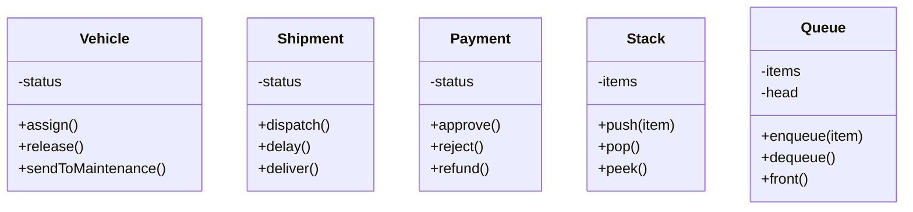

# UC 4 — Modelo de domínio e orientação a objetos

As classes em `src/models` encapsulam regras e estado de objetos centrais:
- `Vehicle`: placa, modelo, capacidade e transições entre AVAILABLE, IN_USE e MAINTENANCE.
- `Shipment`: código de rastreio e transições de PREPARING, IN_TRANSIT, DELAYED e DELIVERED.
- `Payment`: método, valor e transições de PENDING, APPROVED, REJECTED e REFUNDED.
- `Stack`: estrutura LIFO (último a entrar, primeiro a sair).
- `Queue`: estrutura FIFO (primeiro a entrar, primeiro a sair).

Os campos de estado são privados quando necessário. Os métodos validam transições e evitam estados inválidos, demonstrando encapsulamento e responsabilidade de cada classe.
