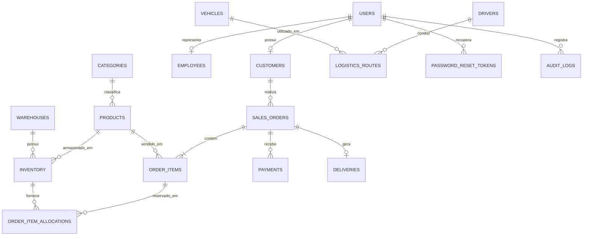

# UC 3 — Modelagem, dicionário de dados e consultas

## Modelo entidade-relacionamento



## Dicionário resumido
| Tabela | Finalidade | Chave principal | Relacionamentos principais |
|---|---|---|---|
| users | Contas, hash de senha, perfil e situação | id | customers, employees, reset tokens, audit logs |
| customers | Dados cadastrais de clientes | id | users; sales_orders |
| employees | Colaboradores internos | id | users |
| categories | Classificação de produtos | id | products |
| products | Catálogo, preço, peso e ativação | id | categories; inventory; order_items |
| warehouses | Centros de distribuição | id | inventory |
| inventory | Quantidade total e reservada por produto/armazém | id | warehouses; products; allocations |
| drivers | Motoristas | id | logistics_routes |
| vehicles | Frota e capacidade de carga | id | logistics_routes |
| logistics_routes | Origem, destino, distância, motorista e veículo | id | drivers; vehicles |
| sales_orders | Cabeçalho, cliente, status e total | id | customers; order_items; payments; deliveries |
| order_items | Produtos e quantidades de cada pedido | id | sales_orders; products; allocations |
| order_item_allocations | Reserva por registro de estoque | id | order_items; inventory |
| payments | Método, valor e status do pagamento | id | sales_orders |
| deliveries | Código e status do rastreamento | id | sales_orders |
| password_reset_tokens | Hash do código temporário e validade | id | users |
| audit_logs | Registro de ações importantes | id | users |

## Normalização
- 1FN: campos armazenam valores atômicos; itens de um pedido ficam em `order_items`, não em colunas repetidas.
- 2FN: atributos não-chave dependem da chave completa; a tabela de alocação relaciona item do pedido e registro de estoque.
- 3FN: categoria, cliente, armazém, motorista e veículo têm tabelas próprias; seus dados não são repetidos em produtos, estoque ou rotas.

## Consultas SQL de evidência
Consulte `database/queries-uc3.sql` para exemplos de SELECT com JOIN, agregação, subconsulta, views e procedures.

## Integridade e segurança
O schema usa PK, FK, UNIQUE, CHECK, índices e InnoDB. O código usa placeholders `?` no mysql2 para reduzir risco de SQL injection. A criação de pedido e reserva de estoque ocorre dentro de transação com bloqueio `FOR UPDATE`.

## Backup e restauração
```bash
mysqldump -h 127.0.0.1 -P 3307 -u root -p omnilog_hub > backup.sql
mysql -h 127.0.0.1 -P 3307 -u root -p omnilog_hub < backup.sql
```
