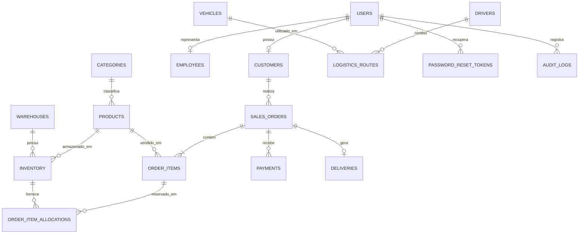

# UC 3 — Modelagem, dicionário de dados e consultas

## Modelo entidade-relacionamento



## Dicionário resumido
| Tabela | Finalidade | Chave principal | Relacionamentos principais |
|---|---|---|---|
| users | Contas, hash de senha, perfil e situação | id | customers, employees, reset tokens, audit logs |
| customers | Dados cadastrais de clientes | id | users; sales_orders |
| employees | Colaboradores internos | id | users |
| categories | Classificação de produtos | id | products |
| products | Catálogo, preço, peso e ativação | id | categories; inventory; order_items |
| warehouses | Centros de distribuição | id | inventory |
| inventory | Quantidade total e reservada por produto/armazém | id | warehouses; products; allocations |
| drivers | Motoristas | id | logistics_routes |
| vehicles | Frota e capacidade de carga | id | logistics_routes |
| logistics_routes | Origem, destino, distância, motorista e veículo | id | drivers; vehicles |
| sales_orders | Cabeçalho, cliente, status e total | id | customers; order_items; payments; deliveries |
| order_items | Produtos e quantidades de cada pedido | id | sales_orders; products; allocations |
| order_item_allocations | Reserva por registro de estoque | id | order_items; inventory |
| payments | Método, valor e status do pagamento | id | sales_orders |
| deliveries | Código e status do rastreamento | id | sales_orders |
| password_reset_tokens | Hash do código temporário e validade | id | users |
| audit_logs | Registro de ações importantes | id | users |

## Normalização
- 1FN: campos armazenam valores atômicos; itens de um pedido ficam em `order_items`, não em colunas repetidas.
- 2FN: atributos não-chave dependem da chave completa; a tabela de alocação relaciona item do pedido e registro de estoque.
- 3FN: categoria, cliente, armazém, motorista e veículo têm tabelas próprias; seus dados não são repetidos em produtos, estoque ou rotas.

## Consultas SQL de evidência
Consulte `database/queries-uc3.sql` para exemplos de SELECT com JOIN, agregação, subconsulta, views e procedures.

## Integridade e segurança
O schema usa PK, FK, UNIQUE, CHECK, índices e InnoDB. O código usa placeholders `?` no mysql2 para reduzir risco de SQL injection. A criação de pedido e reserva de estoque ocorre dentro de transação com bloqueio `FOR UPDATE`.

## Relatórios materializados

O MySQL não oferece suporte nativo a materialized views. Para atender à necessidade de relatórios consolidados, o projeto utiliza a tabela `daily_logistics_summary`, que armazena snapshots diários dos indicadores logísticos.

A procedure `sp_refresh_daily_logistics_summary` atualiza esses dados para a data informada. Assim, os relatórios podem consultar valores previamente consolidados, sem recalcular todos os indicadores a cada leitura.

As views `vw_inventory_summary` e `vw_logistics_summary` são views convencionais, atualizadas conforme os dados das tabelas de origem.

## Backup, restauração e recuperação de desastre

O backup é gerado pelo script `scripts/backup-db.js`, que utiliza `mysqldump` com as opções `--single-transaction`, `--routines`, `--triggers` e `--events`, incluindo as estruturas e rotinas do banco.

Para gerar um backup manual:

```bash
mysqldump -h 127.0.0.1 -P 3307 -u root -p --single-transaction --routines --triggers --events --no-tablespaces omnilog_hub > backup.sql
```

Para restaurar em um banco de destino isolado:

```bash
mysql -h 127.0.0.1 -P 3307 -u root -p omnilog_restore_test < backup.sql
```

**Evidência do teste de recuperação — 04/11/2026**

Foi criado o banco `omnilog_restore_test` e restaurado nele o backup `omnilog_hub_2026-11-04T19-43-33-690Z.sql`, sem erros.

A verificação posterior confirmou:
- 19 tabelas físicas restauradas;
- 2 views restauradas;
- 4 procedures restauradas;
- 6 produtos, 3 categorias, 2 armazéns e 12 registros de estoque;
- 1 fechamento diário de faturamento e 1 resumo diário logístico.

O teste foi realizado em um banco separado, preservando o banco original `omnilog_hub`. Isso demonstra a recuperação das estruturas, rotinas e dos dados conferidos no cenário de teste.